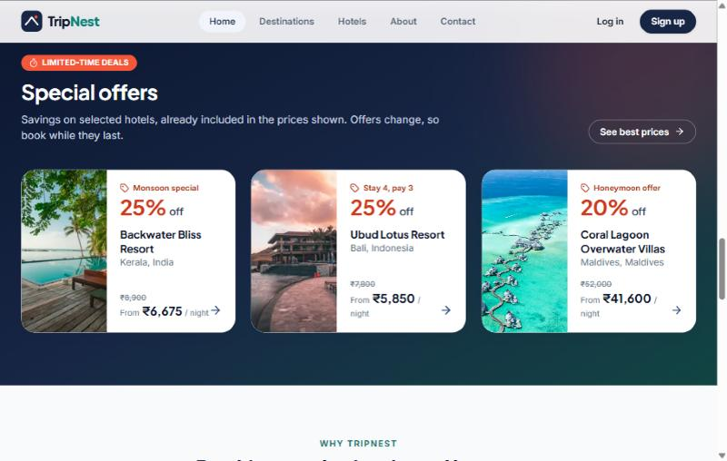
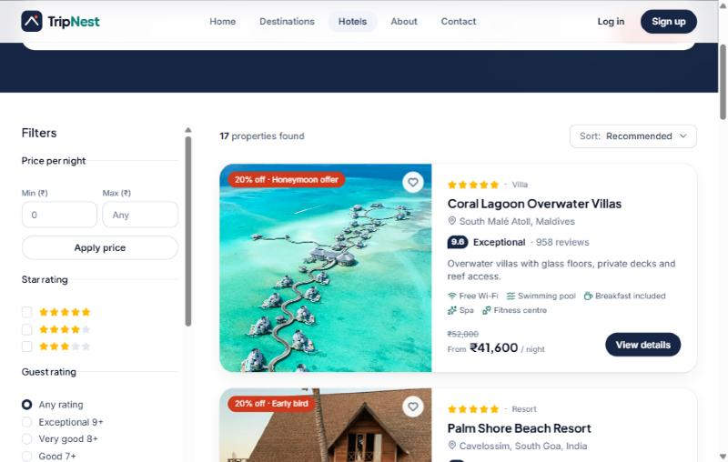
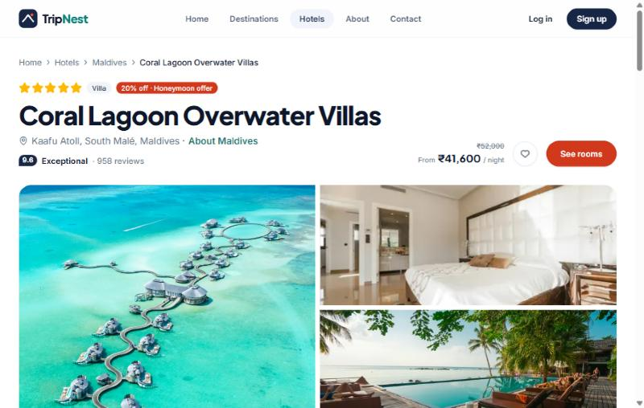
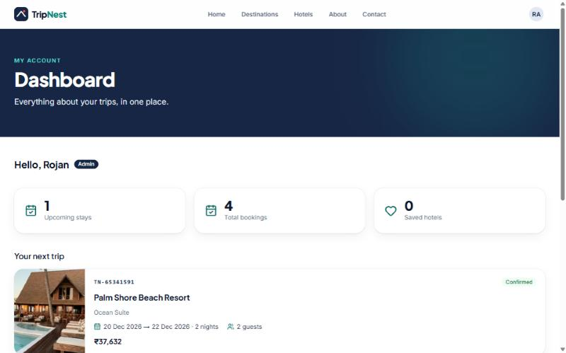
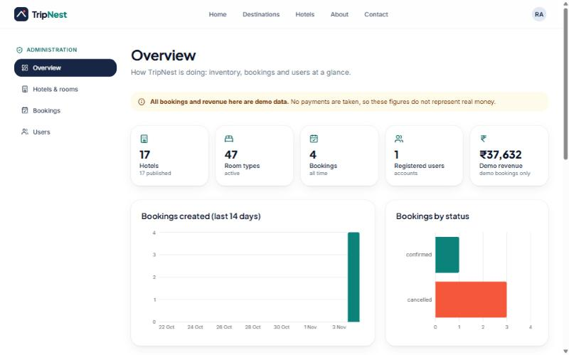
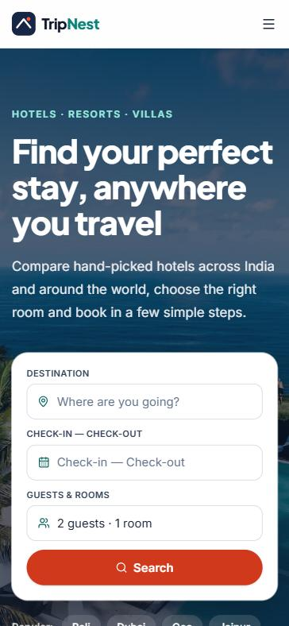

# TripNest — Travel Booking Platform

A full-stack hotel booking platform built as a portfolio project: search and compare hotels, choose a room, pay in
**Razorpay test mode**, manage your trips, and run the whole thing from an admin dashboard.

**Live demo:** <https://tripnest-travel-booking-platform.vercel.app> ·
**Source:** <https://github.com/rojanaugustine999/tripnest-travel-booking-platform>

> **Demo project.** All hotels, prices and reviews are fictional sample data. **No real money is ever taken and no real
> hotel is contacted.** Payments use Razorpay's _test mode_ only (the app refuses live keys; see
> [docs/PAYMENTS.md](docs/PAYMENTS.md)). Photos are from Unsplash.

|                                                                 |                                                                  |
| --------------------------------------------------------------- | ---------------------------------------------------------------- |
|  |       |
|        |  |
|                |            |

<p align="center">
  <br />
  <sub>Responsive: the same pages on a 390 px phone screen.</sub>
</p>

## Objectives

- Build a realistic, production-style booking platform end to end: public site, accounts, bookings, payments and
  administration.
- Keep it **secure by design**: Row Level Security on every table, server-side validation and authorization, payment
  signatures verified inside the database, no secrets in the browser.
- Practise professional habits: typed code, small features, tests for the risky parts, documentation, a phase-by-phase
  history (see [docs/ROADMAP.md](docs/ROADMAP.md)).

## Features

**Visitors**

- A landing page with an **auto-playing hero slideshow** (previous / next, dots, pause; respects "reduce motion"),
  one-click popular destinations, a trust strip, featured hotels, special offers, testimonials and a newsletter form.
- Destinations and hotels with search (accent-insensitive), filters (price, stars, rating, type, amenities,
  availability), sorting and pagination — all computed in one SQL function.
- Hotel pages with gallery, amenities, policies, reviews, room comparison and live availability for chosen dates.
- Social preview image, favicon and Apple touch icon, so shared links look right.

**Signed-in users**

- Registration, login, password reset (Supabase Auth), profile and password change.
- Save hotels (no duplicates), view and remove them.
- Booking: guest details → review → confirm → pay → confirmation with a reference. The price is calculated **on the
  server**, availability is checked under a database lock (no overbooking), and a repeated submission cannot create
  two bookings.
- **Razorpay test-mode payments** (optional, off until configured): the booking is held for 15 minutes and confirmed
  only after the payment's signatures are verified **inside the database**. Unpaid bookings expire and release the
  room. A "Pay now" button and a receipt are shown on the booking pages.
- My bookings with details, price snapshot, payment receipt and cancellation of future bookings.

**Administrators**

- Overview with statistics and charts (demo revenue is clearly labelled).
- Hotels (add, edit, publish, archive, images, amenities), rooms (prices, occupancy, availability), bookings
  (filters, permitted status changes, payment status) and users (role changes, never your own).

## Pages

| Area    | Pages                                                                                                      | Who can open them                   |
| ------- | ---------------------------------------------------------------------------------------------------------- | ----------------------------------- |
| Public  | `/` home · `/destinations` · `/destinations/[slug]` · `/hotels` · `/hotels/[slug]` · `/about` · `/contact` | Everyone                            |
| Account | `/login` · `/register` · `/forgot-password` · `/reset-password`                                            | Everyone                            |
| Guest   | `/dashboard` · `/bookings` · `/bookings/[reference]` · `/saved-hotels` · `/profile`                        | Signed-in users                     |
| Booking | `/booking` (guest details, review, pay) · `/confirmation/[reference]`                                      | Signed-in users                     |
| Admin   | `/admin` · `/admin/hotels` (+ new, edit, rooms) · `/admin/bookings` (+ details) · `/admin/users`           | Admins only (404 for everyone else) |

## Technology stack

| Area       | Technology                                                                                             |
| ---------- | ------------------------------------------------------------------------------------------------------ |
| Framework  | Next.js 16 (App Router, Cache Components, Server Actions, `proxy.ts`, `next/og`), React 19, TypeScript |
| Styling/UI | Tailwind CSS 4, shadcn/ui on Radix, Lucide icons, Recharts (admin charts)                              |
| Forms      | React Hook Form + Zod (validated in the browser **and** again on the server)                           |
| Backend    | Supabase: PostgreSQL, Auth, Row Level Security, SQL functions (`@supabase/ssr`)                        |
| Payments   | Razorpay Standard Checkout in **test mode**; HMAC-SHA256 signatures checked in Postgres (`pgcrypto`)   |
| Testing    | Vitest unit tests, `tsx` scripts for logic and live-database security probes, Lighthouse               |
| Tooling    | ESLint, Prettier                                                                                       |
| Hosting    | Vercel (see [docs/DEPLOYMENT.md](docs/DEPLOYMENT.md))                                                  |

## Getting started

Requirements: **Node.js 20.9 or newer**, npm, and a free [Supabase](https://supabase.com) account.

```bash
git clone https://github.com/rojanaugustine999/tripnest-travel-booking-platform.git
cd tripnest-travel-booking-platform
npm install
cp .env.example .env.local
```

### 1. Create the Supabase project and load the database

Follow [docs/SUPABASE_SETUP.md](docs/SUPABASE_SETUP.md). In short:

1. Create a new Supabase project (leave "automatically expose new tables" **off**).
2. Run the SQL files in `supabase/migrations/` **in order** (8 files, the last one adds payments), then
   `supabase/seed.sql` (sample data), using either the Supabase CLI (`npm run db:push`) or the dashboard SQL Editor.
3. Put the **Project URL** and **publishable key** in `.env.local`. Never use the secret key in the browser and never
   commit `.env.local`.
4. Under Authentication → URL Configuration set the Site URL to `http://localhost:3000` and add
   `http://localhost:3000/**` as a redirect URL.

### 2. Environment variables

| Variable                                                 | Needed?  | Purpose                                                                                      |
| -------------------------------------------------------- | -------- | -------------------------------------------------------------------------------------------- |
| `NEXT_PUBLIC_SUPABASE_URL`                               | Yes      | Your Supabase project URL                                                                    |
| `NEXT_PUBLIC_SUPABASE_PUBLISHABLE_KEY`                   | Yes      | Supabase publishable key (safe in the browser; access is limited by RLS)                     |
| `NEXT_PUBLIC_SITE_URL`                                   | Yes      | The site's own address, used for metadata and auth email links                               |
| `RAZORPAY_KEY_ID`, `RAZORPAY_KEY_SECRET`                 | Optional | Razorpay **test** keys (`rzp_test_…`). Server only. Without them, bookings confirm instantly |
| `NEXT_PUBLIC_CONTACT_EMAIL`, `NEXT_PUBLIC_CONTACT_PHONE` | Optional | Real contact details for the footer and contact page; hidden when empty                      |

### 3. Run it

```bash
npm run dev      # http://localhost:3000
```

To try the admin area, register an account, then run this once in the Supabase SQL Editor (admin rights cannot be
granted from the website):

```sql
update public.profiles set role = 'admin' where email = 'your-email@example.com';
```

To try payments, follow [docs/PAYMENTS.md](docs/PAYMENTS.md) (about 15 minutes) and pay with Razorpay's test card.

## Scripts and testing

| Script                     | Purpose                                                                         |
| -------------------------- | ------------------------------------------------------------------------------- |
| `npm run dev`              | Start the dev server                                                            |
| `npm run build`            | Production build                                                                |
| `npm run start`            | Serve the production build                                                      |
| `npm run lint`             | ESLint                                                                          |
| `npm run typecheck`        | TypeScript type-check                                                           |
| `npm run format`           | Format with Prettier                                                            |
| `npm test`                 | Vitest unit tests (redirect guard, prices, validators, payment signatures)      |
| `npm run test:logic`       | Check validators, price maths and the redirect guard with hostile input         |
| `npm run db:check`         | Test the live Supabase project as a signed-out visitor (reads `.env.local`)     |
| `npm run db:security`      | Probe the live database like an attacker (reads, writes, functions)             |
| `npm run db:push`          | Apply new migrations to the linked Supabase project (`-- --dry-run` to preview) |
| `npm run db:types`         | Regenerate `src/types/database.ts` from the linked project                      |
| `npm run db:seed:generate` | Rebuild `supabase/seed.sql` from the sample data                                |

**Current results:** 24 Vitest tests, 55 logic checks and 28 database security probes all pass. A SQL self-check for
the payment functions is in `supabase/tests/check-payments.sql`.

**Lighthouse** (production build, mobile emulation): accessibility **100** on the home, hotels and hotel pages,
best practices **96**, SEO **100**, performance **79–90** (the large Unsplash photos dominate Largest Contentful
Paint). Full results, bugs found and fixed, and what was not verified are in [docs/TESTING.md](docs/TESTING.md).

## How it is secured

- **Row Level Security** on all 14 tables with explicit per-role grants. Users only see their own profile, bookings,
  payments and saved hotels; only admins manage the catalogue.
- **Bookings cannot be written from the browser.** The `create_booking`, `cancel_booking`, `confirm_booking_payment`
  and `admin_*` SQL functions check who is calling, re-validate everything and are not executable by signed-out
  visitors.
- **Payments:** the server creates the Razorpay order from the price stored in the database. A booking is confirmed
  only when Postgres itself verifies Razorpay's signature **and** a binding token tying that order to one booking and
  one amount, using a secret that never reaches the browser. A forged or replayed call is refused. Only `rzp_test_`
  keys are accepted.
- **Server-side authorization:** `requireUser()` / `requireAdmin()` and every Server Action check the verified session
  and the role stored in the database; admin pages return 404 to everyone else.
- **Headers:** CSP (allowing only Supabase, Unsplash and Razorpay), `X-Frame-Options`, `nosniff`, referrer and
  permissions policies, HSTS.
- **Secrets:** only `.env.example` is committed. The Supabase secret key is not used by the app at all.

## Project structure

```
src/
├─ app/
│  ├─ (public)/      home, destinations, hotels, about, contact
│  ├─ (auth)/        login, register, password reset
│  ├─ (user)/        dashboard, bookings, saved hotels, profile
│  ├─ booking/       booking flow          confirmation/  booking confirmation
│  ├─ admin/         overview, hotels, rooms, bookings, users
│  └─ icon / apple-icon / opengraph-image   favicon and social preview, generated at build time
├─ components/       ui/ (shadcn), common/ (shared pieces), layout/ (navbar, footer)
├─ features/         destinations, hotels, rooms, bookings, payments, saved-hotels, profile, auth, admin, marketing
├─ lib/              supabase/ clients, auth/ session helpers, payments/ (Razorpay), validations/, utils/
├─ proxy.ts          session refresh + route protection
└─ types/            domain types and database.ts (generated from the live schema)
supabase/            migrations/ (schema, RLS, SQL functions, payments), seed.sql, tests/ (SQL self-check)
tests/               Vitest unit tests
scripts/             seed generator, db:check, db:security, test:logic
docs/                roadmap, Supabase setup, payments, testing report, deployment guide, screenshots
```

## Documentation

| Document                                         | What it covers                                                    |
| ------------------------------------------------ | ----------------------------------------------------------------- |
| [docs/SUPABASE_SETUP.md](docs/SUPABASE_SETUP.md) | Creating the database, migrations, auth URLs, custom email (SMTP) |
| [docs/PAYMENTS.md](docs/PAYMENTS.md)             | How the Razorpay test payments work and how to switch them on     |
| [docs/DEPLOYMENT.md](docs/DEPLOYMENT.md)         | GitHub and Vercel steps, environment variables, troubleshooting   |
| [docs/TESTING.md](docs/TESTING.md)               | Security, functionality, responsive and Lighthouse results        |
| [docs/ROADMAP.md](docs/ROADMAP.md)               | The 12 build phases and what each delivered                       |

## Deployment

The site is deployed on Vercel and rebuilds on every push to `main`. Step-by-step instructions for GitHub and Vercel,
including the Supabase settings you must change for the live site, are in [docs/DEPLOYMENT.md](docs/DEPLOYMENT.md).

## Known limitations

- Payments are **test mode only**. There is no webhook (confirmation relies on the browser returning from the
  payment window; if it is closed at that exact moment the booking expires), and no refunds. See
  [docs/PAYMENTS.md](docs/PAYMENTS.md).
- Real hotel inventory and booking emails are **not** implemented. Supabase's built-in email service sends only 2 auth
  emails per hour; use your own SMTP for more ([docs/SUPABASE_SETUP.md](docs/SUPABASE_SETUP.md)).
- Hotel images are Unsplash links, not uploads.
- Search results do not filter by dates (availability is shown on the hotel and booking pages).
- Reviews and testimonials are sample data.
- See [docs/TESTING.md](docs/TESTING.md) for everything that was and was not verified.

## Credits

Photography from [Unsplash](https://unsplash.com) under the Unsplash licence. Icons by Lucide. Built by Rojan
Augustine as a learning and portfolio project.
